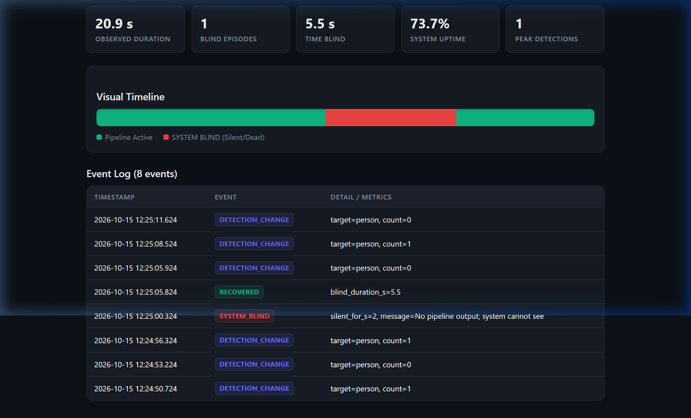
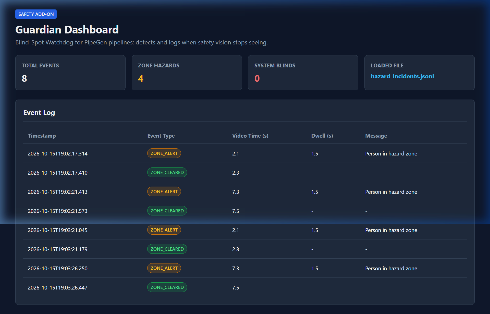

# Blind-Spot Watchdog for PipeGen

**HackwithBangalore 4.0** | [Event Link](https://luma.com/5z8w42mq) | **Track 2:** PipeGen (Computer Vision & Edge AI)

> **Important Status Note:** CPU test tool (OpenCV HOG), PipeGen/TensorRT/GPU run pending, no NVIDIA GPU available.

---

## Problem
Vision-based safety systems typically only show what the camera actively detects. When a camera is disconnected, a video stream freezes, or the inference pipeline crashes, traditional setups fail silently. Operators and automated safety interlocks remain unaware that the system is blind. For any safety-critical application, a silent failure is the worst-case scenario.

## The Idea: Fail Loudly
The **Blind-Spot Watchdog** acts as an independent heartbeat and health-monitoring supervisor for a vision pipeline:
- **SYSTEM BLIND Alert:** Triggers immediately within a configurable timeout (e.g. 2–3 seconds) if the pipeline stops emitting output.
- **RECOVERED Alert:** Automatically detects when the pipeline resumes, logging the exact blind downtime duration.
- **Incident Logging:** Records detection state changes (such as target person counts) and all failure/recovery events into a structured JSONL log (`incident_log.jsonl`).
- **Zone Hazard Sentinel:** Monitors hazardous work zones and raises `ZONE_ALERT` when persons stay in the danger zone longer than a dwell threshold (`hazard_incidents.jsonl`).
- **Visual Dashboard:** Provides an interactive web dashboard (`dashboard.html`) to inspect downtime timelines, uptime percentage, and incident histories.
- **MQTT Integration:** Optionally broadcasts alerts directly to an MQTT broker for plant-floor integration.

---

## Project Structure & Files

| File | Purpose |
|---|---|
| `watchdog.py` | Core watchdog process (Python standard library only; optional `paho-mqtt`). Monitors feed heartbeat and logs `SYSTEM_BLIND` / `RECOVERED`. |
| `cpu_video_demo.py` | CPU safety sentinel (OpenCV HOG). Detects persons, checks hazard zone dwell times, emits `feed.jsonl` and `hazard_incidents.jsonl`. |
| `dashboard.html` | Self-contained visual dashboard for incident log review (timeline, metrics, events table, drag & drop). |
| `evaluate.py` | Precision / recall / false-alarm evaluation matrix generator from ground-truth CSVs. |
| `PIPEGEN_PLAN.md` | Full architecture blueprint, requirement sentence, and GPU-day deployment runbook. |
| `run_demo.bat` | One-click Windows demo launcher (runs self-test simulation & generates incident log). |
| `run_demo.sh` | One-click Linux / macOS demo launcher. |
| `.gitignore` | Ignores runtime artifacts and heavy video files (`incident_log.jsonl`, `feed.jsonl`, `*.mp4`). |

---

## Live Video Demo (Dual Terminal Setup)

This live demo runs on **any laptop** (no NVIDIA GPU required) using real video input:

### Terminal 1: Vision Sentinel (Pipeline Simulator)
```bash
python cpu_video_demo.py --source myvideo.mp4 --realtime --dwell 1.5
```
*Processes video at real speed, tracks persons in the hazard zone, and continuously writes heartbeat updates to `feed.jsonl`.*

### Terminal 2: Blind-Spot Watchdog
```bash
python watchdog.py --path feed.jsonl --timeout 2
```
*Watches `feed.jsonl`. As long as frames are processed, it reports active detection counts.*

### The Standout Demo Action:
1. In **Terminal 1**, press `Ctrl + C` (or let the video finish) to simulate an edge camera unplugged, stream freeze, or pipeline crash.
2. In **Terminal 2**, within **~2.0 seconds** of silence, the Watchdog loudly alerts:
   ```text
   [2026-10-15T19:03:06.813] SYSTEM BLIND - no pipeline output for >2.0s
   ```
3. Restart Terminal 1 to resume feed: the Watchdog logs:
   ```text
   [2026-10-15T19:03:19.342] RECOVERED after 12.5s blind
   ```

---

## Dashboard Visualizations

Open `dashboard.html` in your browser. Drag and drop any generated log file to inspect it:

1. **Watchdog Heartbeat & Downtime (`incident_log.jsonl`):**
   - Displays total observed duration, blind episodes, exact blind time, and system uptime percentage.
   - Interactive visual timeline bar: Green (Active) vs Red (SYSTEM BLIND).

   

2. **Workplace Zone Hazard Incidents (`hazard_incidents.jsonl`):**
   - Displays zone hazard events, dwell time in danger area, video timestamp, and zone clearance records.

   

---

## Quick Start (Synthetic Self-Test Demo)

If no video is available, run the simulated demo:
- **Windows:** Double-click `run_demo.bat`
- **Linux / macOS:** `./run_demo.sh`
- The 22-second synthetic demo simulates silence at second 8 and recovery at second 15, generating `incident_log.jsonl`.

---

## Evaluation Harness

To generate a precision / recall / accuracy table:
```bash
python evaluate.py ground_truth.csv predictions.csv
```

**CSV Format:**
- `ground_truth.csv`: `clip,expected` (1 = danger event present, 0 = normal)
- `predictions.csv`: `clip,predicted` (1 = alert triggered by pipeline, 0 = no alert)

---

## Scope & Limitations (Honest & Transparent)

- **Detector Scope:** `cpu_video_demo.py` uses OpenCV's default HOG descriptor (`cv2.HOGDescriptor`) to detect pedestrians on CPU. HOG is a classic, basic detector; it may miss small, distant, or partially occluded individuals and is not a substitute for a trained deep learning model.
- **Purpose:** This CPU tool serves as a functional demonstration harness so that the watchdog supervisor, heartbeat detection, alert escalation, and web dashboard can be proven end-to-end on live video without requiring an NVIDIA GPU.
- **Hardware Status:**
  - [x] Architecture design and failure-mode monitoring concept.
  - [x] Full `watchdog.py` implementation with timeout detection and incident logging.
  - [x] `cpu_video_demo.py` CPU sentinel running on live video.
  - [x] Interactive `dashboard.html` with uptime timeline and hazard incident review.
  - [x] `evaluate.py` evaluation script with Markdown table generator.
  - [ ] **Pending GPU hardware:** Physical PipeGen pipeline compilation (TensorRT FP16/INT8) and live camera deployment on an NVIDIA GPU.
